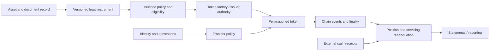

# Capital infrastructure & tokenization — engineering review

**Public technical review · Edition 4 · 27 November 2026**

[Return to Web3 engineering](../web3-collaboration.md) · [Source repository](https://github.com/Noetfield-Systems/VELTARIS) · [Developer interface](https://veltaris-capital.vercel.app/developer.html) · [Fictional credit workspace](https://veltaris-capital.vercel.app/workspace.html)

This review concerns software architecture, capital operations and the design of permissioned token systems. It is not a financial offering, a legal opinion, a live token issuance or a statement that the entire capital platform is operational.

## 1. Product thesis and actual maturity

The project begins with a useful private-credit operations product, rather than requiring every borrower and lender to move their records to a blockchain. A future token can represent an identified instrument under agreed rights and transfer rules; it is not itself proof of ownership or settlement.

The inspected source and documentation distinguish the following layers:

| Domain | Existing documented slice | Further engineering |
|---|---|---|
| Origin & Asset Registry | Organization-scoped facilities, revisions, documents | Source-linked extraction, asset and entitlement provenance |
| Credit & Instrument Builder | Whole-cent schedule and stateless whole-unit issuance calculation | Versioned legal instrument and authoritative position records |
| Policy | Stateless pause, sender/recipient eligibility, holding checks | Actual identity registry, attestation expiry, transfer rules, revocation |
| Token Studio | Off-chain simulator | Permissioned contract, Foundry, deployment evidence |
| Capital & Institutional | Software demonstration and invitation-only pilot workflow | External financial integrations and commercial evidence |
| Settlement & Servicing | Documented receipt allocation, reference matching, compensating journal reversal | Bank feed, payment execution, chain reconciliation, fund GL |
| Investor & Exchange Connect | Roadmap | Investor holdings, authorized secondary venue integration |
| Developer | Versioned simulation API and OpenAPI | SDK, events, idempotency, contract adapters and webhooks |

The full [master blueprint](https://github.com/Noetfield-Systems/VELTARIS/blob/5bfd84b036dff07d7a75a91d42e6cb3d9f01f829/docs/master-blueprint.md) defines 14 modules. The [implementation tracker](https://github.com/Noetfield-Systems/VELTARIS/blob/5bfd84b036dff07d7a75a91d42e6cb3d9f01f829/docs/execution.md) explicitly marks token factory deployment and Foundry testing pending. This review does not upgrade those status labels.

## 2. Reproducible source-level results

Pinned public revision: **5bfd84b036dff07d7a75a91d42e6cb3d9f01f829**.

| Source | Git blob SHA-1 |
|---|---|
| [capital.mjs](https://github.com/Noetfield-Systems/VELTARIS/blob/5bfd84b036dff07d7a75a91d42e6cb3d9f01f829/public/capital.mjs) | 05dcca4269a4a5044c297efdfeddea38fec25d06 |
| [capital.test.mjs](https://github.com/Noetfield-Systems/VELTARIS/blob/5bfd84b036dff07d7a75a91d42e6cb3d9f01f829/test/capital.test.mjs) | 2209bb99402452daaaea9a1b76240bdf970f0097 |
| [issuance API handler](https://github.com/Noetfield-Systems/VELTARIS/blob/5bfd84b036dff07d7a75a91d42e6cb3d9f01f829/api/issuance-simulate.mjs) | 2e0763170259ec7dfd4b0bb69807c171c966811f |

The three source files were reproduced byte-for-byte, independently checked against their Git blob identifiers, then executed locally with Node 22.16.0. The original five tests passed. The additional [regression runner](../reference/review-capital.mjs) invokes the actual simulator rather than reimplementing its code. It checks all eight combinations of three Boolean policy flags for each of 1,024 deterministically generated numerical scenarios, using integer BigInt comparisons for conservation and settlement value.

| Run | Observed result |
|---|---:|
| Original unit tests | 5/5 pass |
| Deterministic transfer scenarios | 8,192 pass |
| Allowed / denied | 526 / 7,666 |
| Invalid input rejection | 12/12 pass |
| Maximum principal boundary | 1/1 pass |
| Direct handler response cases | 7/7 pass |

The allowed/denied distribution is a generated test population, not a market statistic. Direct handler invocation tests return codes and headers against mock request/response objects; it does not exercise live HTTP ingress or database persistence. These are actual software results, not EVM tests or an independent security audit.

```bash
git clone https://github.com/Noetfield-Systems/VELTARIS.git
git -C VELTARIS checkout 5bfd84b036dff07d7a75a91d42e6cb3d9f01f829
(cd VELTARIS && node --test test/capital.test.mjs)
git clone https://github.com/Noetfield-Systems/sina-gateway.git
node sina-gateway/docs/engineering/reference/review-capital.mjs VELTARIS
```

## 3. Issuance and transfer semantics

The existing stateless API accepts principal and price in whole CAD cents, sender holdings, requested whole units and Boolean eligibility/pause flags. The [OpenAPI description](https://github.com/Noetfield-Systems/VELTARIS/blob/5bfd84b036dff07d7a75a91d42e6cb3d9f01f829/public/v1/openapi.json) documents the request and response schemas.

For principal P, unit price U, proposed total units N and sender holdings H:

- Require P > 0, U > 0, P mod U = 0; N = P / U.
- Require 0 ≤ H ≤ N and requested units Q > 0.
- Allow iff not paused, both participants eligible, Q ≤ H.
- If allowed, X = Q, otherwise X = 0; sender after = H − X; recipient after = X; transferred value = X × U.
- Preserve H across the two returned balances, and never create value on a denied transfer.

Example synthetic scenario: C$100,000 principal, C$100 unit price, 1,000 proposed units, 200 sender units and 75 requested. A permitted transfer returns 125 and 75 units respectively, C$7,500 represented transfer value. **No cash, token or entitlement changes hands.**

## 4. Serious limitations identified in the source review

| Boundary | Why it matters | Next engineering evidence |
|---|---|---|
| Caller-supplied Boolean flags | A client can choose eligibility in a simulator; these are not authoritative identity checks | Independent identity attestations, expiry and revocation; test negative cases |
| Recipient balance starts at zero | The result is a one-transfer illustration, not a full position ledger | Versioned multi-party holdings and conservation across sequences |
| No asset or instrument identity | A scenario has no persistent instrument, issuer, chain or legal document reference | Instrument registry and explicit authority/domain binding |
| Stateless transfer calculation | A replay evaluates the same hypothetical inputs rather than mutating canonical state | Idempotent ledger writes and transaction reconciliation |
| Declared content length | Handler checks the header; this does not prove a transport-level byte limit | Actual ingress/body-parser checks with malformed and chunked requests |
| Exact cents | Inputs are bounded below Number.MAX_SAFE_INTEGER; settled value is bounded by principal under the current logic | Retain bounds and migrate to explicit integer/decimal serialization for wider financial domains |
| No chain execution | Output says simulation, no wallet, receipt or real asset | Implement and test permissioned contracts, independently verify exact deployment |

These are identified scope boundaries and review questions, not an assertion of exploitable vulnerabilities in a production financial system.

## 5. Proposed permissioned issuance architecture



Target EVM architecture (not shipped): an explicitly governed issuer role; identity registry and claim validity; transfer policy; integer supply and position ledger; custody-neutral wallet interface; event-based reconciliation; documented emergency and migration authority. Study ERC-3643 where permissioned transfers are necessary; do not adopt a standard without reviewing the actual asset rights, jurisdiction and operator responsibilities.

### Settlement lifecycle

Instrument draft → signed terms and approvals → authorized issuance → token allocation → permitted transfer → servicing → maturity or redemption → reconciliation. Each transition must bind the instrument, version, actor, amount, identity evidence, and source of authority. A receipt is not an independent legal entitlement.

### Contract acceptance targets

| ID | Target property | Required proof |
|---|---|---|
| RWA-01 | Mint/burn only with issuer authority; total supply equals valid allocations | Unit and stateful invariant tests |
| RWA-02 | Transfer checks both participants, policy version and expiry | Fuzz policy combinations and revocation |
| RWA-03 | Pause/freeze actions cannot create balances or change entitlement silently | Multi-actor authorization tests |
| RWA-04 | Transfer failure rolls back all state and emits no successful settlement | Exact revert and event tests |
| RWA-05 | Signed authorization is bound to chain, instrument, nonce and deadline | Cross-domain replay and stale signature tests |
| RWA-06 | Chain events reconcile with authoritative positions through reorg and duplicate delivery | Integration and fork scenarios |
| RWA-07 | Cash receipts remain separate from projected schedules; reversals preserve history | Ledger and reconciliation tests |
| RWA-08 | No private borrower data or credential enters public calldata or metadata | Privacy review and adversarial tests |

## 6. Financial operations are more than token issuance

The [servicing documentation](https://github.com/Noetfield-Systems/VELTARIS/blob/5bfd84b036dff07d7a75a91d42e6cb3d9f01f829/docs/servicing.md) describes recorded external cash receipts, exact-reference/amount matching, and balanced CAD journal entries. Debit cash; credit principal receivable and cash-basis interest income; corrections use compensating entries rather than rewriting history. The documented release is manual and one-to-one; it does not execute payments, implement a fund GL or automatically ingest bank data. The [portal documentation](https://github.com/Noetfield-Systems/VELTARIS/blob/5bfd84b036dff07d7a75a91d42e6cb3d9f01f829/docs/portal.md) describes separate operator and tenant permissions. Those flows were not independently executed in this review.

The next commercial milestone can be a real software pilot in private-credit operations while contract engineering progresses separately. A technical co-founder should be able to own one bounded system—permissioned asset lifecycle, wallet authorization, or chain-to-ledger reconciliation—and debate its failure modes, customer workflow and acceptance evidence.

## 7. Joint engineering starting point

Review the actual simulator and existing tests, run the independent regression runner, then propose a minimal stateful permissioned-transfer specification. Compare a standard implementation with a minimal custom policy adapter. Define who issues and revokes credentials, how an operator is constrained, where asset identity is anchored, and what settlement must prove. Build on a test chain before making claims about real issuance. No claim of a deployed ERC-3643 contract, live investor platform, funded assets, paid usage or external audit is made here.
