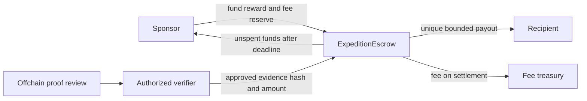

# Web3 & EVM Engineering — Technical Collaboration

**Sina Kazemnezhad | Vancouver, Canada**  
Founder & venture builder · AI, financial infrastructure and onchain systems

[Personal introduction](https://sina-collaborate.vercel.app) · [GitHub organization](https://github.com/Noetfield-Systems)

This is a technical entry point for engineers, protocol architects, prospective technical co-founders and strategic technology partners. It is a curated engineering brief, not an investment solicitation, a claim of audited production infrastructure, or a comprehensive inventory of private ventures.

**Start here:** [Solidity source](https://github.com/Noetfield-Systems/SEEKMESH/blob/9e0e004d58949ebc7e26f300e96843554bbecf09/contracts/ExpeditionEscrow.sol) · [Foundry tests](https://github.com/Noetfield-Systems/SEEKMESH/blob/9e0e004d58949ebc7e26f300e96843554bbecf09/test/ExpeditionEscrow.t.sol) · [CI workflow](https://github.com/Noetfield-Systems/SEEKMESH/blob/9e0e004d58949ebc7e26f300e96843554bbecf09/.github/workflows/onchain-escrow.yml)

## 01 — Engineering focus

| Area | Scope | Evidence level |
|---|---|---|
| EVM settlement | Pre-funded escrow, bounded reward and fee accounting, replay protection, expiry refunds | Public Solidity source |
| Smart-contract QA | Foundry compilation and targeted negative-path tests | Public test and workflow source; fresh run not asserted |
| Wallet-native applications | Nonce-bound wallet authentication, Web3 application integration | Public project documentation |
| Financial data systems | Crypto research, market-data APIs, provenance-aware analysis | Public application and repository |
| Token infrastructure | Factories, fixed supply, vesting, Merkle distribution, registries, settlement | Confidential technical review only; not publicly evidenced here |
| DEX and financial execution | Wallet-authorized orders, liquidity routing and execution interfaces | Confidential technical review only; not a claim of live trading |
| AI-assisted development | Intelligent agents, product engineering, structured automation | Related public code and product exploration |

Each venture has its own ownership and commercial context. Technical code hosting does not imply common legal ownership.

## 02 — Public Solidity case: funded mission escrow

**Project:** SEEKMESH — an independent Web3 discovery and participation project.  
**Contract:** ExpeditionEscrow, Solidity 0.8.24.  
**Status:** Reference implementation, explicitly unaudited and undeployed in the inspected contract header. No mainnet receipt is claimed.

### System boundary



The contract is not a decentralized judge of work quality. Evidence eligibility is determined offchain by an authorized verifier; its authority is an explicit trust assumption.

### Contract mechanics

| Mechanism | Implemented behavior |
|---|---|
| Funding | Sponsor deposits the reward budget plus fee reserve; incoming token balance delta must match the required amount. |
| Authorization | The designated verifier is the only payout authority; sponsor is the refund authority. |
| Replay protection | A campaign-scoped evidence hash is marked used before payment. |
| Accounting | Reward spend and fee spend are tracked separately and bounded by their respective budgets. |
| Fees | Fee calculated per settled payout; maximum configured fee 500 bps. |
| Time | Payout closes at deadline; sponsor refund becomes available at deadline. |
| Refund | Remaining rewards and unearned fee reserve are returned once. |
| External calls | Low-level token calls validate success and accepted return data; a reentrancy guard covers state-changing operations. |

### Evidence and reproducibility

Reviewed revision: `9e0e004d58949ebc7e26f300e96843554bbecf09`.

```bash
git clone https://github.com/Noetfield-Systems/SEEKMESH.git
cd SEEKMESH
git checkout 9e0e004d58949ebc7e26f300e96843554bbecf09
forge build
forge test -vv
```

Requires Git and Foundry. The repository's Foundry profile specifies Solidity 0.8.24 and optimizer runs of 200.

| Test source | Behavior exercised |
|---|---|
| testFundPayUniqueAndRefundAllUnspent | Funding, payout, fee, residual balance, refund and duplicate refund |
| testOneEvidenceCannotPayTwice | Evidence replay prevention |
| testUnauthorizedVerifierAndOverBudget | Authorization and budget limits |
| testSponsorCannotRugActiveCampaign | Early refund and late payout rejection |
| testFeeLimitAndNoFakeFunding | Fee limit and failed funding |
| testMultipleProofsFeesAndFullRewardUtilization | Multiple payments and full allocation |

[Read the exact contract](https://github.com/Noetfield-Systems/SEEKMESH/blob/9e0e004d58949ebc7e26f300e96843554bbecf09/contracts/ExpeditionEscrow.sol) · [Read the exact tests](https://github.com/Noetfield-Systems/SEEKMESH/blob/9e0e004d58949ebc7e26f300e96843554bbecf09/test/ExpeditionEscrow.t.sol) · [Foundry configuration](https://github.com/Noetfield-Systems/SEEKMESH/blob/main/foundry.toml) · [Actions history](https://github.com/Noetfield-Systems/SEEKMESH/actions)

**Verification boundary:** six named test functions are present in the inspected source. A CI workflow invokes Forge. This brief does not claim a fresh passing run, coverage percentage, successful fork test, independent audit, deployment, or paid settlement.

### Technical review agenda

- Model balance conservation across multiple campaigns, payment and refund operations.
- Evaluate centralized verifier compromise, rotation and emergency recovery.
- Review transfer semantics, rounding dust, nonstandard tokens and outbound balance effects.
- Add fuzz/property and stateful invariant coverage, adversarial token mocks, boundary cases and gas profiling.
- Validate a real stablecoin integration on a pinned testnet or fork and record transaction receipts before claiming onchain execution.

These are proposed review/extension tasks, not shipped features.

## 03 — Related public engineering

| Project | Relevant scope | Links |
|---|---|---|
| SEEKMESH | Wallet-native Web3 discovery, EIP-4361 authentication documentation, escrow and application integration | [Repository](https://github.com/Noetfield-Systems/SEEKMESH) · [Wallet documentation](https://github.com/Noetfield-Systems/SEEKMESH/blob/main/docs/WALLET_NATIVE_V1.md) · [Application](https://seekmesh-web-production.up.railway.app/) |
| SignalForge | Financial market data, research terminal, AI-assisted analysis, read-only crypto market intelligence | [Repository](https://github.com/Noetfield-Systems/SignalForge) · [Application](https://signalforge-web-production.up.railway.app/) |

These are supplementary application-engineering references, not evidence that a new DEX, protocol, exchange or financial service is production-ready. Live application URLs are supplied by their project documentation; availability is not independently retested in this brief.

## 04 — Confidential engineering tracks

Some commercial repositories remain private. Relevant areas for a scoped technical walkthrough include token factories, fixed-supply assets, vesting, Merkle claims, registries, stablecoin fee settlement, Foundry/Hardhat workflows and wallet-signed transaction integration. For DEX integrations, distinguish original engineering from upstream code and respect upstream licenses.

A private repository link is not a public proof artifact. Access, if appropriate, is arranged separately for the specific project. No private source, internal configuration, unpublished venture identity, credential or customer record is included in this document. The private tracks above are discussion scopes, not publicly verified deliverables.

## 05 — Engineering standard and collaborative work

A serious protocol collaboration should produce artifacts that a reviewer can reproduce independently.

| Layer | Target artifacts |
|---|---|
| Requirements | Protocol specification, roles, assets, trust assumptions and failure modes |
| Contract architecture | Minimal interfaces, explicit state transitions, storage and upgrade policy |
| Quality | Unit, fuzz, invariant, fork and adversarial tests; dependency pinning |
| Security | Threat model, static analysis, remediation register, independent review where appropriate |
| Operations | Deterministic build, CI, deployment scripts, verified addresses and receipts |
| Integration | Typed ABIs/SDK, wallet signing and transaction reconciliation |
| Product | User journeys, realistic market assumptions and measurable acceptance criteria |

Reference engineering ecosystems (for study, not claimed equivalence or affiliation): [Foundry](https://github.com/foundry-rs/foundry), [OpenZeppelin Contracts](https://github.com/OpenZeppelin/openzeppelin-contracts), [Uniswap v4 core](https://github.com/Uniswap/v4-core), [Safe smart account](https://github.com/safe-global/safe-smart-account).

### Technical collaboration routine

1. **Discovery:** exchange non-confidential project objectives, existing architecture, chain requirements and team capabilities.
2. **Review:** agree on one relevant subsystem; inspect code, reproduce tests, identify tradeoffs and document gaps.
3. **Design:** define a small implementation milestone with interfaces, acceptance tests, ownership and responsibilities.
4. **Build:** work through a scoped branch or sandbox, with reviewable changes and automated evidence.
5. **Verify:** reproduce the result independently, record commit and CI references, and use testnet receipts where applicable.
6. **Decide:** agree on the next milestone and commercial or co-founder terms if the technical and interpersonal fit is mutual.

Possible relationships: technical co-founder, protocol engineering partner, product integration partner, joint venture or scoped engineering engagement. No position, funding or equity is promised by this brief.

## 06 — Evidence maintenance

For every new public claim, record the project, source permalink, commit, verification method and outcome. Keep source observations separate from execution receipts, audits, production deployments and commercial results. Update this brief when a new verified artifact becomes available. Retain private review material outside the public identity repository.

| Evidence item | Current classification |
|---|---|
| Public repository visibility | Confirmed for SEEKMESH and SignalForge |
| Escrow source and six test definitions | Inspected |
| Foundry CI configuration | Inspected |
| Fresh CI execution and independent security assessment | Not verified in this brief |
| Paid mainnet transaction and commercial traction | Not claimed |

**Reviewed:** 2026-11-27.  
**Contact:** [Personal collaboration portal](https://sina-collaborate.vercel.app).
