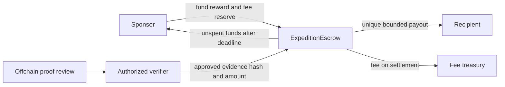
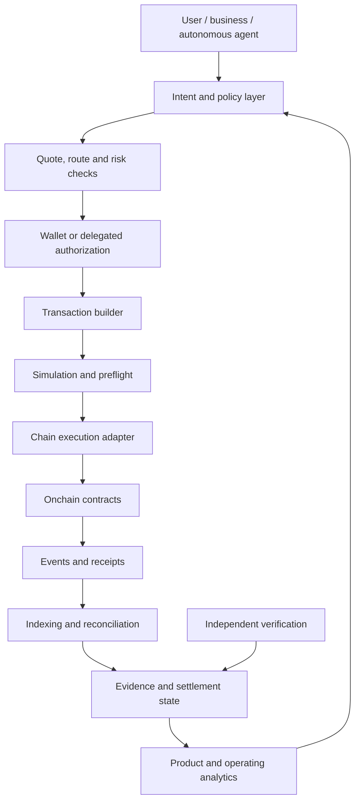
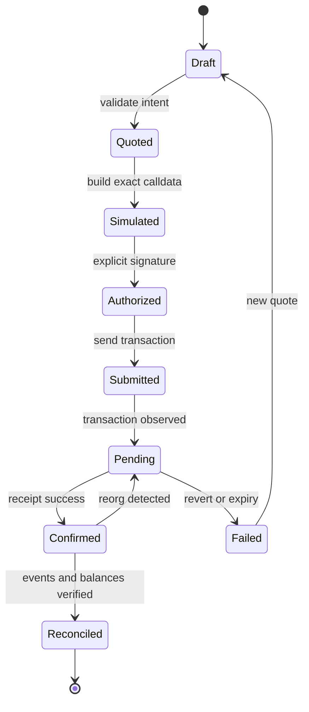

# Web3 & EVM Engineering | Research, Protocols & Ventures

**Technical collaboration dossier · Edition 3 · November 2026**  
Sina Kazemnezhad — Founder & venture builder, Vancouver, Canada

[Personal collaboration portal](https://sina-collaborate.vercel.app) · [Public engineering evidence](#02--public-solidity-case-funded-mission-escrow) · [Reference model](reference/escrow-accounting.mjs) · [Protocol architecture](#07--architecture-for-an-onchain-economic-network) · [Build program](#11--research-and-delivery-program) · [Co-founder collaboration](#12--technical-leadership-and-co-founder-fit)

> The opportunity is not another collection of token contracts. It is to engineer trustworthy, programmable economic infrastructure: systems in which human teams, autonomous agents and businesses can create assets, coordinate work, transact, and verify the result.

## Portfolio-wide technical entry points

Web3 collaboration spans several distinct product directions, not a single escrow demonstration. The public entry points below deliberately separate inspectable implementation, product demonstrations and research targets.

| Direction | Public entry point | Current boundary |
|---|---|---|
| Agent economies and token-native products | [ARQANT product introduction](https://arqant-web-production.up.railway.app/) | Emerging agent economy; token issuance and funded activity are not claimed. Public product link, not private source access. |
| RWA, private credit and tokenization | [VELTARIS repository](https://github.com/Noetfield-Systems/VELTARIS) · [Developer quickstart](https://veltaris-capital.vercel.app/developer.html) · [Credit workspace](https://veltaris-capital.vercel.app/workspace.html) | Software prototype and off-chain policy/issuance simulations; the permissioned EVM token and Foundry verification are development targets, not deployed infrastructure. |
| Web3 discovery and wallet-native settlement | [SEEKMESH source](https://github.com/Noetfield-Systems/SEEKMESH) · [Escrow contract](https://github.com/Noetfield-Systems/SEEKMESH/blob/9e0e004d58949ebc7e26f300e96843554bbecf09/contracts/ExpeditionEscrow.sol) | Public source, wallet integration and contract tests; no funded escrow deployment or paid settlement claimed. |
| Crypto markets and financial data | [SignalForge source](https://github.com/Noetfield-Systems/SignalForge) | Market research and data application, not a live exchange or independently validated trading system. |

### Areas for substantive technical collaboration

- Token lifecycle engineering: factory design, fixed-supply asset issuance, vesting, distributions, Merkle claim semantics and lifecycle accounting.
- RWA protocol design: instrument representations, identity-bound eligibility, restricted transfers, servicing, reconciliation and the boundary between legal rights and onchain state. VELTARIS documents the intended [architecture](https://github.com/Noetfield-Systems/VELTARIS/blob/main/docs/master-blueprint.md) and distinguishes released simulations from pending contracts in its [implementation tracker](https://github.com/Noetfield-Systems/VELTARIS/blob/main/docs/execution.md).
- Self-custodial exchange and liquidity integration: signed intents, execution quotes, slippage, settlement and failure handling.
- Agent-native economic applications: accountable execution, wallet authorization, payment and contribution workflows.

These are collaboration directions, not a claim that all listed modules are production-deployed. More detailed review of nonpublic work is available only through separately agreed, scoped access. Public product links do not confer repository access, ownership rights or proof of current availability.

## Executive technical thesis

A durable onchain company must connect protocol engineering with real product distribution and economic activity. Tokens alone do not create a market; agents alone do not produce a trusted execution system. The technical direction is to connect **intent → authorization → execution → settlement → independently verifiable evidence**, while retaining user control over funds and explicit economic boundaries.

The purpose of this dossier is to initiate a substantive peer-level discussion with a technical co-founder or senior protocol engineer. We welcome disagreement on architecture, security assumptions, performance, product economics and the actual value of building onchain. A credible collaborator should be able to inspect a subsystem, reproduce its behavior, identify its weaknesses, propose a better solution and own delivery.

### Evidence map — start with what can be inspected

| Artifact | Evidence available today | Review path |
|---|---|---|
| Stablecoin mission escrow | Public Solidity source, six named tests, Foundry configuration and CI definition | [Exact source](https://github.com/Noetfield-Systems/SEEKMESH/blob/9e0e004d58949ebc7e26f300e96843554bbecf09/contracts/ExpeditionEscrow.sol) |
| Reproducible accounting reference | Standalone deterministic BigInt model; 2,048 simulated scenarios and 22,960 payout transitions executed in the authoring runtime | [Executable model](reference/escrow-accounting.mjs) |
| Wallet-native integration | Public Web3 application documentation and implementation repository | [SEEKMESH](https://github.com/Noetfield-Systems/SEEKMESH) |
| Market intelligence | Public financial data and AI research application repository | [SignalForge](https://github.com/Noetfield-Systems/SignalForge) |
| Deeper contract systems | Token factories, vesting, claims, settlement, DEX integration; scoped private review | No public source or deployment proof claimed here |

**Evidence labels:** SOURCE = inspected code; MODEL = independently executable abstract behavior; RUN = recorded actual test execution; CHAIN = verified onchain receipt; AUDIT = independently assessed security; COMMERCIAL = observed external paid usage. These labels are not interchangeable. The model run is not an EVM test, and a code link is not a mainnet receipt.

## 01 — Engineering focus

| Area | Scope | Evidence level |
|---|---|---|
| EVM settlement | Pre-funded escrow, bounded reward and fee accounting, replay protection, expiry refunds | Public Solidity source |
| Smart-contract QA | Foundry compilation and targeted negative-path tests | Public test and workflow source; fresh run not asserted |
| Wallet-native applications | Nonce-bound wallet authentication, Web3 application integration | Public project documentation |
| Financial data systems | Crypto research, market-data APIs, provenance-aware analysis | Public application and repository |
| Token infrastructure | Factories, fixed supply, vesting, Merkle distribution, registries, settlement | Confidential technical review only; not publicly evidenced here |
| DEX and financial execution | Wallet-authorized orders, liquidity routing and execution interfaces | Confidential technical review only; not a claim of live trading |
| AI-assisted development | Intelligent agents, product engineering, structured automation | Related public code and product exploration |

Each venture has its own ownership and commercial context. Technical code hosting does not imply common legal ownership.

## 02 — Public Solidity case: funded mission escrow

**Project:** SEEKMESH — an independent Web3 discovery and participation project.  
**Contract:** ExpeditionEscrow, Solidity 0.8.24.  
**Status:** Reference implementation, explicitly unaudited and undeployed in the inspected contract header. No mainnet receipt is claimed.

### System boundary



The contract is not a decentralized judge of work quality. Evidence eligibility is determined offchain by an authorized verifier; its authority is an explicit trust assumption.

### Contract mechanics

| Mechanism | Implemented behavior |
|---|---|
| Funding | Sponsor deposits the reward budget plus fee reserve; incoming token balance delta must match the required amount. |
| Authorization | The designated verifier is the only payout authority; sponsor is the refund authority. |
| Replay protection | A campaign-scoped evidence hash is marked used before payment. |
| Accounting | Reward spend and fee spend are tracked separately and bounded by their respective budgets. |
| Fees | Fee calculated per settled payout; maximum configured fee 500 bps. |
| Time | Payout closes at deadline; sponsor refund becomes available at deadline. |
| Refund | Remaining rewards and unearned fee reserve are returned once. |
| External calls | Low-level token calls validate success and accepted return data; a reentrancy guard covers state-changing operations. |

### Evidence and reproducibility

Reviewed revision: `9e0e004d58949ebc7e26f300e96843554bbecf09`.

```bash
git clone https://github.com/Noetfield-Systems/SEEKMESH.git
cd SEEKMESH
git checkout 9e0e004d58949ebc7e26f300e96843554bbecf09
forge build
forge test -vv
```

Requires Git and Foundry. The repository's Foundry profile specifies Solidity 0.8.24 and optimizer runs of 200.

| Test source | Behavior exercised |
|---|---|
| testFundPayUniqueAndRefundAllUnspent | Funding, payout, fee, residual balance, refund and duplicate refund |
| testOneEvidenceCannotPayTwice | Evidence replay prevention |
| testUnauthorizedVerifierAndOverBudget | Authorization and budget limits |
| testSponsorCannotRugActiveCampaign | Early refund and late payout rejection |
| testFeeLimitAndNoFakeFunding | Fee limit and failed funding |
| testMultipleProofsFeesAndFullRewardUtilization | Multiple payments and full allocation |

[Read the exact contract](https://github.com/Noetfield-Systems/SEEKMESH/blob/9e0e004d58949ebc7e26f300e96843554bbecf09/contracts/ExpeditionEscrow.sol) · [Read the exact tests](https://github.com/Noetfield-Systems/SEEKMESH/blob/9e0e004d58949ebc7e26f300e96843554bbecf09/test/ExpeditionEscrow.t.sol) · [Foundry configuration](https://github.com/Noetfield-Systems/SEEKMESH/blob/main/foundry.toml) · [Actions history](https://github.com/Noetfield-Systems/SEEKMESH/actions)

**Verification boundary:** six named test functions are present in the inspected source. A CI workflow invokes Forge. This brief does not claim a fresh passing run, coverage percentage, successful fork test, independent audit, deployment, or paid settlement.

### Technical review agenda

- Model balance conservation across multiple campaigns, payment and refund operations.
- Evaluate centralized verifier compromise, rotation and emergency recovery.
- Review transfer semantics, rounding dust, nonstandard tokens and outbound balance effects.
- Add fuzz/property and stateful invariant coverage, adversarial token mocks, boundary cases and gas profiling.
- Validate a real stablecoin integration on a pinned testnet or fork and record transaction receipts before claiming onchain execution.

These are proposed review/extension tasks, not shipped features.

## 03 — Related public engineering

| Project | Relevant scope | Links |
|---|---|---|
| SEEKMESH | Wallet-native Web3 discovery, EIP-4361 authentication documentation, escrow and application integration | [Repository](https://github.com/Noetfield-Systems/SEEKMESH) · [Wallet documentation](https://github.com/Noetfield-Systems/SEEKMESH/blob/main/docs/WALLET_NATIVE_V1.md) · [Application](https://seekmesh-web-production.up.railway.app/) |
| SignalForge | Financial market data, research terminal, AI-assisted analysis, read-only crypto market intelligence | [Repository](https://github.com/Noetfield-Systems/SignalForge) · [Application](https://signalforge-web-production.up.railway.app/) |

These are supplementary application-engineering references, not evidence that a new DEX, protocol, exchange or financial service is production-ready. Live application URLs are supplied by their project documentation; availability is not independently retested in this brief.

## 04 — Confidential engineering tracks

Some commercial repositories remain private. Relevant areas for a scoped technical walkthrough include token factories, fixed-supply assets, vesting, Merkle claims, registries, stablecoin fee settlement, Foundry/Hardhat workflows and wallet-signed transaction integration. For DEX integrations, distinguish original engineering from upstream code and respect upstream licenses.

A private repository link is not a public proof artifact. Access, if appropriate, is arranged separately for the specific project. No private source, internal configuration, unpublished venture identity, credential or customer record is included in this document. The private tracks above are discussion scopes, not publicly verified deliverables.

## 05 — Engineering standard and collaborative work

A serious protocol collaboration should produce artifacts that a reviewer can reproduce independently.

| Layer | Target artifacts |
|---|---|
| Requirements | Protocol specification, roles, assets, trust assumptions and failure modes |
| Contract architecture | Minimal interfaces, explicit state transitions, storage and upgrade policy |
| Quality | Unit, fuzz, invariant, fork and adversarial tests; dependency pinning |
| Security | Threat model, static analysis, remediation register, independent review where appropriate |
| Operations | Deterministic build, CI, deployment scripts, verified addresses and receipts |
| Integration | Typed ABIs/SDK, wallet signing and transaction reconciliation |
| Product | User journeys, realistic market assumptions and measurable acceptance criteria |

Reference engineering ecosystems (for study, not claimed equivalence or affiliation): [Foundry](https://github.com/foundry-rs/foundry), [OpenZeppelin Contracts](https://github.com/OpenZeppelin/openzeppelin-contracts), [Uniswap v4 core](https://github.com/Uniswap/v4-core), [Safe smart account](https://github.com/safe-global/safe-smart-account).

### Technical collaboration routine

1. **Discovery:** exchange non-confidential project objectives, existing architecture, chain requirements and team capabilities.
2. **Review:** agree on one relevant subsystem; inspect code, reproduce tests, identify tradeoffs and document gaps.
3. **Design:** define a small implementation milestone with interfaces, acceptance tests, ownership and responsibilities.
4. **Build:** work through a scoped branch or sandbox, with reviewable changes and automated evidence.
5. **Verify:** reproduce the result independently, record commit and CI references, and use testnet receipts where applicable.
6. **Decide:** agree on the next milestone and commercial or co-founder terms if the technical and interpersonal fit is mutual.

Possible relationships: technical co-founder, protocol engineering partner, product integration partner, joint venture or scoped engineering engagement. No position, funding or equity is promised by this brief.

## 06 — Evidence maintenance (baseline)

For every new public claim, record the project, source permalink, commit, verification method and outcome. Keep source observations separate from execution receipts, audits, production deployments and commercial results. Update this brief when a new verified artifact becomes available. Retain private review material outside the public identity repository.

| Evidence item | Current classification |
|---|---|
| Public repository visibility | Confirmed for SEEKMESH and SignalForge |
| Escrow source and six test definitions | Inspected |
| Foundry CI configuration | Inspected |
| Fresh CI execution and independent security assessment | Not verified in this brief |
| Paid mainnet transaction and commercial traction | Not claimed |


## 07 — Architecture for an onchain economic network

**Target architecture / research proposal.** This describes a direction for joint design, not a claim that every component exists. Each venture can adopt only the modules it needs; identities, assets, treasuries, data and contracts remain isolated by deployment and operator.



### Domain decomposition

| Bounded context | Proposed responsibility | Explicit non-responsibility |
|---|---|---|
| Identity & authority | EOA authentication, optional smart accounts, scoped session permissions, nonce and replay controls | No custody of user seed phrases; login signature is not transaction consent |
| Asset issuance | Template registry, fixed supply or explicitly governed minting, vesting, allocation manifests, verified bytecode | No arbitrary issuance behind a trusted label |
| Distribution | Merkle claims, epoch limits, allocation accounting, expiration, referral evidence | No automatic financial entitlement from offchain points |
| Settlement | Pre-funded escrows, exact-value payments, fee accounting, idempotent receipts | No assumption that pending transactions are final |
| Exchange integration | Quote normalization, allowance handling, signed orders, execution and settlement reconciliation | No claim of proprietary liquidity or execution when using upstream protocols |
| Capital workflows | Asset and obligation representations, payment schedules, attestations and permissioned transfer policies where needed | No implied authorization to offer regulated financial instruments |
| Agent execution | Goal decomposition, tool permissions, simulation, budget constraints, human-authorized financial effects | A model must not create signing authority by reasoning about a goal |
| Evidence | Source revision, compiler artifact, event log, chain ID, transaction hash, independently observed result | No synthetic metric promoted to live activity |

### Execution semantics



An authorization is bound to the chain, contract, call parameters, amount, deadline and relevant nonce. An idempotency key prevents an application retry from creating a second economic instruction. A transaction hash is a submission identifier, not success; receipt status and expected events must be checked. A confirmed receipt can be affected by a chain reorganization, so settlement policies define confirmation depth and reconciliation behavior.

### Proposed interfaces

The following TypeScript interface sketches are design targets, not implemented SDK declarations.

```typescript
type Address = `0x${string}`;
type Hash = `0x${string}`;

type EconomicIntent = {
  id: string;
  chainId: number;
  actor: Address;
  operation: "fund" | "settle" | "claim" | "swap";
  asset: Address;
  amountAtomic: bigint;
  recipient: Address;
  deadline: number;
  policyVersion: string;
};

type ExecutionPlan = {
  intentId: string;
  chainId: number;
  to: Address;
  calldata: Hash;
  nativeValue: bigint;
  quoteExpiresAt: number;
  simulationBlock: bigint;
};

type ExecutionReceipt = {
  intentId: string;
  chainId: number;
  txHash: Hash;
  blockNumber: bigint;
  blockHash: Hash;
  status: "confirmed" | "reverted" | "reorged";
  observedEvents: readonly Hash[];
};
```

Amounts are always integer atomic units and never IEEE-754 floating point. UI formatting is not ledger accounting. Cross-chain portability requires adapter-specific token addresses, finality policy, gas token and RPC assumptions rather than treating every EVM chain as identical.

### Architectural decisions worth debating

| Decision | Default research position | Alternative to evaluate |
|---|---|---|
| Contract immutability | Prefer small immutable modules with explicit migrations | Proxy upgrades only when justified; storage compatibility, admin authority and exit guarantees |
| Authorization | User wallet signs financial effects; scoped delegated authority when genuinely needed | ERC-4337 smart accounts, EIP-712 typed permissions and EIP-1271 contract signatures |
| Token transfers | Explicitly supported assets and exact amount semantics | Generalized ERC-20 handling with carefully specified fee/rebase behavior |
| Liquidity | Integrate existing, well-understood liquidity first | A new AMM only if the economic and technical thesis justifies it |
| Data | Chain events plus a reconciled offchain projection | Direct RPC-only reads for critical paths; indexer redundancy for availability |
| Economics | Revenue tied to delivered activity and settled value | Other models evaluated against unit economics and user incentives |

## 08 — Deep technical case study: escrow accounting and protocol boundaries

The public contract makes a useful narrow case because it has a precise state machine and tractable accounting invariants.

### Formal accounting model

For campaign i, let B be the original reward budget, r the fee rate in basis points, F = floor(B × r / 10,000), S the cumulative rewards paid, and P the cumulative fee paid.

- Initial deposit D = B + F.
- For each accepted reward a, fee f = floor(a × r / 10,000), with a > 0.
- S' = S + a, P' = P + f.
- Before refund, outstanding liability L = B − S + F − P.
- After successful expiry refund, L = 0; refund amount equals the pre-refund liability.
- 0 ≤ S ≤ B and 0 ≤ P ≤ F.
- For an exact-transfer, non-rebasing token and no unsolicited deposits, total contract balance equals the sum of open campaign liabilities.
- With unsolicited deposits, the expected relationship is balance ≥ liability; surplus must not be misclassified as campaign funding.

Integer division makes fee aggregation non-additive: the sum of floors of individual fees cannot exceed the floor of the total fee. Splitting payouts can leave fee reserve dust, which the sponsor recovers on expiry. This is a deliberate economic question for the next version: define whether fees should be rounded per payout or against cumulative spend.

### Executable reference model

[escrow-accounting.mjs](reference/escrow-accounting.mjs) is a dependency-free JavaScript reference model derived from the public accounting semantics. Run it with Node.js:

```bash
git clone https://github.com/Noetfield-Systems/sina-gateway.git
cd sina-gateway
node docs/engineering/reference/escrow-accounting.mjs
```

Observed authoring-runtime result on 2026-11-27:

```json
{
  "status": "PASS",
  "deterministicScenarios": 2048,
  "payouts": 22960,
  "explicitNegativeCases": 6,
  "scope": "BigInt accounting model; not EVM execution"
}
```

The run checks aggregate liability, conservation, reward and fee bounds, campaign isolation, duplicate proofs, authorization, over-budget payout, deadline behavior and duplicate refunds. The deterministic PRNG seed makes scenario generation repeatable. This is an arithmetic and state-model exercise: it does not execute Solidity, reproduce uint256 overflow behavior, simulate token callbacks, model gas, establish actual balances onchain, or provide formal verification of the contract. A differential Foundry harness should compare Solidity against the same oracle.

### Proposed threat model and review register

The observations below are preliminary source review and design questions, not a completed security audit.

| Risk / failure mode | Observed boundary | Recommended next evidence |
|---|---|---|
| Verifier compromise | Designated verifier can spend a campaign's available reward budget before expiry; no rotation path in the inspected version | Explicit verifier trust policy; rotation or threshold approval design, compromise simulations |
| Sponsor cancellation | Sponsor cannot reclaim before deadline | Document business tradeoff; assess mutual cancellation and disputes |
| Replay | Hash uniqueness is campaign-scoped | Check canonical evidence construction and cross-campaign policy; do not claim global replay resistance |
| Outbound token semantics | Low-level call success checked; recipient balance delta is not checked | Restrict supported tokens or verify exact outbound balance changes; test fee-on-transfer and rebasing behavior |
| Direct transfers | No explicit surplus-accounting or rescue method in inspected source | Define surplus policy without permitting access to campaign liabilities |
| Expiry and liveness | Refund depends on sponsor calling after deadline | Evaluate keeper-assisted execution that cannot redirect funds; test timestamp boundaries |
| Returned state | remaining() reports arithmetic remainder even after refund | Improve API semantics or expose explicit lifecycle-aware liability; integration regression tests |
| Rounding | Fee is rounded down per reward | Document dust and test partition sensitivity; choose economic policy |
| External callback | Guard protects fund/pay/refund; no malicious-token test observed | Add reentrancy, false-return, malformed-return and callback mocks |
| Stablecoin issuer controls | Freeze/blacklist behavior is outside the contract's control | Model rejected transfer and recovery scenarios; disclose liveness assumptions |
| Test quality | Existing negative paths use try/catch and balance assertions | Prefer exact custom-error matching where practical; stateful multi-actor and differential tests |
| Dependency reproducibility | CI selects Foundry stable; checkout/toolchain tags not immutable pins | Pin release and reviewed workflow action revisions; record compiler settings and artifacts |

### Acceptance matrix for the next contract iteration

| ID | Property | Method | Target outcome |
|---|---|---|---|
| EVM-01 | Conservation of funded assets | Stateful invariant across multiple sponsors and campaigns | No deficit or unauthorized value creation |
| EVM-02 | Unique evidence settlement | Fuzz repeated IDs and evidence hashes | No duplicate payout within a campaign |
| EVM-03 | Authority isolation | Multi-actor tests and exact reverts | No unauthorized payout or refund |
| EVM-04 | Deadline boundary | Warp before, at and after deadline | Mutually exclusive payout/refund availability |
| EVM-05 | Atomic rollback | Mock reverting or false-return tokens | Failed transfer leaves all economic state unchanged |
| EVM-06 | External-call safety | Adversarial callback mock | No successful reentrant economic transition |
| EVM-07 | Fee behavior | Differential comparison against reference model | Bounded fee reserve, documented rounding |
| EVM-08 | Deployment reproducibility | Pinned compiler, ABI/bytecode hashes, testnet receipt | Reviewer can reproduce and reconcile release |
| EVM-09 | Operational recovery | Failure injection and sponsor/verifier key-loss review | No undocumented privileged recovery path |

These are target acceptance tests. Do not display them as passed until test logs and the reviewed commit are recorded.

## 09 — Engineering research tracks

The larger opportunity is modular infrastructure rather than an unrelated list of apps. The following tracks can be owned independently and assembled around a concrete use case.

### A. Asset factory and distribution

Research scope: minimal fixed-supply factory; explicit mint/upgrade permissions when required; deterministic allocation; vesting; Merkle proof distribution; funded claims; epoch expiry; event-based reconciliation. A deployment registry binds an asset to creator, chain, template version, runtime code hash and release evidence.

Technical questions: factory provenance vs. deterministic CREATE2 addresses; migration of immutable templates; bitmap vs. mapping claim accounting; leaf encoding and domain separation; replay across chains; fee and gas optimization; ownership transfer and multisig control. A public release should contain a complete source/test/receipt trail rather than a deploy button alone.

### B. Self-custodial exchange and financial execution

Research scope: EVM quote adapters, normalized exact-input/exact-output quotes, allowance scope, deadlines, slippage bounds, route comparison, order signing, transaction simulation and settlement verification. Begin with interoperable integrations; a new pricing curve or liquidity mechanism requires an explicit advantage and economic analysis.

Technical questions: MEV exposure; sandwich resistance and batch settlement; quote expiry and stale liquidity; nonstandard tokens; partial fills; duplicate order submissions; RPC failure; fee accounting; indexer lag. An AMM prototype must include reserve and invariant reasoning, rounding and adversarial execution tests, not only swap UI.

### C. Onchain agent infrastructure

Research scope: structured intents, constrained tool use, deterministic planning boundaries, wallet-authorized execution, budget tracking, evidence generation and independent verification. Model outputs are untrusted proposals until validated against current state and exact transaction parameters.

Technical questions: separation of reasoning and authority; policy bypass; prompt injection from external market data; transaction simulation drift; allowance minimization; nonce synchronization; agent identity; scoped delegation; finality-aware receipts; failover without duplicate effects. The desired outcome is a measurable agent capability, not the number of defined agent roles.

### D. Tokenized capital and real-world assets

Research scope: representation of real obligations, asset onboarding, permissioned transfer policy where required, document attestations, servicing schedules, settlement and reconciliation. A legal right and a token record are distinct; tokenization does not create title or remove applicable obligations by itself.

Technical questions: offchain document integrity, privacy-preserving attestations, verified issuer roles, reconciliation with existing books, payment defaults, redemption and dispute handling. Start with software and non-custodial infrastructure; actual asset issuance or financial activity needs its own evidence and appropriate authorized participants.

### E. Protocol observability and proof

Research scope: canonical event schema; immutable source references; chain receipt verifier; indexer reorg handling; signed evidence manifests; independent replay; incident recovery and reproducible builds. The system should make it possible to answer: what happened, under whose authority, on which chain, for what amount, and which evidence independently confirms it?

## 10 — Benchmark-led engineering

The references below are learning targets, not statements of feature parity, affiliation or equivalent security. Review their actual code, tests, interfaces and design tradeoffs before adopting a pattern.

| Reference | Study target | What to reproduce in our own work |
|---|---|---|
| [Uniswap v4](https://github.com/Uniswap/v4-core) | Pool accounting, settlement boundaries, extensibility | Invariant-first protocol design and explicit callback trust |
| [Aave V3](https://github.com/aave/aave-v3-core) | Lending risk and liquidity accounting | Clear solvency assumptions and multi-actor testing |
| [Safe](https://github.com/safe-global/safe-smart-account) | Smart-account authorization and modular execution | Precise authority boundaries, signatures and replay protection |
| [OpenZeppelin](https://github.com/OpenZeppelin/openzeppelin-contracts) | Standard interfaces, access control, safe token primitives | Reuse audited building blocks without claiming the application is audited |
| [Foundry](https://github.com/foundry-rs/foundry) | Solidity test, fuzz, invariant and fork toolchain | Reproducible contract QA and adversarial state-machine tests |
| [Chainlink](https://github.com/smartcontractkit/chainlink) | Oracle architecture and external data dependencies | Freshness checks, failure behavior and explicit oracle assumptions |
| [CoW Protocol](https://github.com/cowprotocol/contracts) | Signed orders, settlement and solver boundaries | Separate order authorization from settlement and attribute upstream code |
| [Viem](https://github.com/wevm/viem) | Typed EVM integration and ABI handling | Strongly typed wallet interaction and receipt normalization |

A benchmark should produce a decision record: problem, alternatives, observed upstream pattern, reason for adoption or rejection, test implications and expected business value. Do not equate copying a dependency or forking a UI with engineering originality.

## 11 — Research and delivery program

**Proposed milestones for a small joint team, sequenced by evidence rather than calendar promises.** A serious commercial opportunity can proceed in parallel with protocol R&D; no speculative token launch is a prerequisite to selling software or integrations.

| Milestone | Deliverables | Exit evidence |
|---|---|---|
| M0 — Technical alignment | One actual use case; architecture inventory; explicit boundaries; ownership and contribution map | Agreed scope and reproducible baseline |
| M1 — Reference protocol | Harden one escrow or settlement subsystem; state machine; dependency-pinned build | Passing unit and negative-path suite on a recorded commit |
| M2 — Adversarial QA | Differential oracle, fuzz/invariant suite, malicious-token and multi-actor harness, static analysis | Reproducible results and triaged findings |
| M3 — Testnet integration | Wallet-native flow, deploy script, verified contract addresses and event indexing | Public testnet transaction and independent reconciliation |
| M4 — Product integration | Real user journey, typed SDK/API, quote and receipt handling, usability and failure cases | End-to-end test plus real user feedback |
| M5 — Commercial validation | Scoped paid integration, partner pilot, or customer-ready software offer | Real customer outcome and settled payment when applicable |
| M6 — Scale | Operational monitoring, dependency review, documented incident response, independent security review for funds-bearing releases | Reliability metrics and reviewed production release |

### Quality and evidence scorecard

Track actual measurements rather than decorative scores. Relevant metrics include deterministic build status; unit/fuzz/invariant results; uncovered branches; gas by operation; transaction failure/reconciliation rates; RPC latency and availability; time to reproduce a bug; external customer engagement; settled revenue; and incident recovery time. Numeric targets should be chosen after a baseline and use-case constraints are measured.

For security-sensitive changes, review the effect on assets, authority, state transitions, external calls, storage, rounding, denial of service and failure recovery. Releases carrying real user value require evidence appropriate to their actual risk. Low-risk documentation, prototypes and integrations need not wait for unrelated audits.

## 12 — Technical leadership and co-founder fit

We are interested in people who can challenge assumptions and take ownership of outcomes, not merely implement a predefined task list.

**Potential leadership mandate:** shape the technical thesis; choose the right protocol boundaries; establish engineering standards; lead architecture and security decisions; own a focused subsystem through testing, deployment and product adoption; participate in commercial and strategic decisions with the founder.

**Discussion dimensions:** EVM and Solidity depth; protocol economics; distributed systems; security reasoning; ability to ship maintainable software; contribution to product and market fit; communication and mutual trust. Different candidates bring different strengths. No one is expected to possess every skill.

### First joint working session

An engineering discussion should be substantive and reciprocal:

1. Each side explains a real project and its architectural constraints.
2. Choose a concrete subsystem to inspect together: settlement, token factory, exchange integration, agent authorization or another relevant component.
3. Reproduce one actual result, examine a failure case and debate a design tradeoff.
4. Agree on a small mutually useful next milestone, ownership boundaries and evidence of success.
5. Discuss roles and terms separately if there is a genuine technical and interpersonal fit.

No unpaid hiring assignment is required to begin a conversation. A paid engagement, co-founder partnership, joint venture or integration is a distinct relationship with terms agreed by its participants.

### Continuous engineering routine

| Cadence | Practice | Artifact |
|---|---|---|
| Every change | Small reviewable commits, tests and peer review of economic or authorization changes | Commit / PR / reproducible result |
| Weekly | Technical design review, benchmark research, delivery priorities, customer/partner observations | Decision record and scoped next milestone |
| Every release | Verify exact source revision, build artifacts, chain configuration and deployment evidence | Release evidence manifest |
| Monthly | Revisit architecture, economics, operational risk and user feedback; retire weak assumptions | Roadmap adjustment and evidence ledger |

This cadence is a proposed joint working agreement. No scheduled agent or automatic repository update is claimed to be running.

## 13 — Technical review entry points

- [Public Solidity implementation and tests](https://github.com/Noetfield-Systems/SEEKMESH/tree/9e0e004d58949ebc7e26f300e96843554bbecf09)
- [Independent accounting reference model](reference/escrow-accounting.mjs)
- [Personal collaboration portal](https://sina-collaborate.vercel.app)

The pinned public source was reopened and inspected for this edition. The available commit-workflow lookup returned no matching pull-request-triggered runs; therefore fresh Solidity CI results are not asserted. No unpublished project name, private source, credential, production configuration or ownership claim has been added. The architecture, research tracks, milestones and collaboration cadence are proposals for discussion, not completed system claims.

**Last reviewed:** 2026-11-27. This dossier is intended to evolve with verified engineering outcomes.
